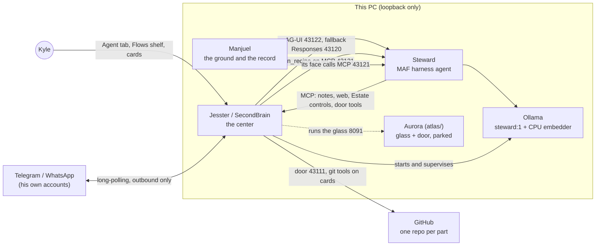
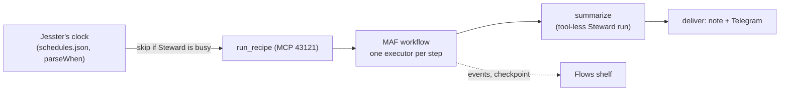

# The Estate's architecture

The one design document for the whole system (Neiro, "the Estate"): its parts, the wires between them, the data each
keeps, how work flows through it, the rules that bind it, and the build plan ahead. It is kept in Steward's
repository because Steward runs the Estate.

- **As of:** 2026-11-05.
- **Decisions:** every architectural decision is an ADR in [`decisions/`](decisions/README.md). Every architectural
  change gets an ADR before it is built, and this file is updated in the same pull request when a decision changes
  the shape (the operator, 2026-11-05: "make this the standard moving forward, this way nothing gets misaligned").
- **Where this disagrees with an older document** (a README, the ground's SPEC.md, a SecondBrain note), this file and
  the ADRs win; the older one carries a dated pointer here.

## 1. The parts



| Part | Repository (GitHub) | Folder on this PC | What it is for |
|---|---|---|---|
| **Steward** | Steward | `worlds/steward` | The Estate's agent: a Microsoft Agent Framework (MAF 1.24) harness agent on local Ollama. Runs everything: code, tests, evals, automations and the Estate's controls. Every write is on Kyle's card. |
| **Jesster** (app: SecondBrain) | Jesster | `worlds/jesster` | The center ([ADR-0004](decisions/0004-jesster-is-the-center.md)): Steward's console (Agent tab and its shelves, Phone view, Flows shelf), the MCP hub, the automations' clock, the Estate's status with every part's version, and the supervisor of Steward's servers and Ollama. |
| **Manjuel** | Manjuel | `Desktop\Research` (the ground) | The ground and the record: the laws (`law/`), the vision (`foundation/`), the history (DAYBOOK, HANDOFF, CHANGELOG) and the Manjuel engine. Its default agent is Steward. |
| **Aurora** | Aurora (renamed from Atlas, 2026-11-05) | `atlas/` | The glass (8091) and the door's original code. Parked until Steward has visible computer control; its look is never changed. |
| **Ollama** | (upstream) | runs under SecondBrain | The model server, 127.0.0.1:11434: `steward:1` for every role ([ADR-0002](decisions/0002-one-model-for-everything.md)) and `embeddinggemma-2:270m` on the CPU. |
| **Neiro** | Neiro (archived) | `worlds/neiro` | The Estate's name. The repository and its lock are retired as a gate ([ADR-0004](decisions/0004-jesster-is-the-center.md)). |

### Steward, inside

- **The agent:** `harness/steward/step04_production_ready/agent.py`, `build_steward_agent`: MAF's harness agent with
  file access over his workspace, a shell behind approval, skills (file skills and SecondBrain's skill notes over
  MCP), CodeAct (Hyperlight sandbox when `STEWARD_SANDBOX=hyperlight`), background agents (CodeExplorer,
  WebResearchAgent), file memory, compaction, looping, OpenTelemetry with the HALO JSONL exporter.
- **The workflow:** `steward_workflow.py`: plan, the `approve_plan` card, execute (the plan's steps as todos), a
  model-free check (pytest), repair (at most 3 attempts), the `git_commit` card, report. Defined once and served by
  every host.
- **The hosts:** `hosted.py` (Responses, 43120), `ag_ui_app.py` (AG-UI, 43122), `mcp_app.py` (MCP, 43121, with
  `run_recipe` and `recipe_status`), `devui_app.py` (DevUI, for development only).
- **The improvement loop:** `improvement_loop_workflow.py`: one change, checks, Kyle's review (keep, drop, guidance),
  checkpointed.
- **Recipes:** `recipe_workflow.py`: an automation built as a MAF workflow ([ADR-0005](decisions/0005-automations-are-recipes-run-as-maf-workflows.md)).
- **Evals:** `evals.py`, `ext_sets.py`, `eval_transports.py` and the versioned sets in `harness/steward/evals/`
  ([ADR-0006](decisions/0006-evals-are-versioned-long-runs-at-night.md)).
- **Skills:** `harness/steward/skills/<name>/SKILL.md` (estate, github, automations, bar-runner, eval-history,
  telemetry, ollama-ops, approvals and others).
- **The Charter:** his instructions, the SecondBrain note `steward-charter` (v4.9), read every turn.

## 2. The wires

All on loopback (127.0.0.1). Nothing listens on another interface.

| Port | Served by | Protocol | Who calls it |
|---|---|---|---|
| 43120 | Steward `hosted.py` | OpenAI Responses (MAF `ResponsesHostServer`) | Jesster, as the fallback transport; evals `--transport responses` |
| 43121 | Steward `mcp_app.py` | MCP (streamable HTTP) | Manjuel's face (`MANJUEL_MCP_STEWARD`), Aurora's `ask_steward` (atlas-mcp, Atlas #42), Jesster's `run_recipe` / `recipe_status` |
| 43122 | Steward `ag_ui_app.py` | AG-UI (MAF `agent_framework_ag_ui`) | Jesster's Agent tab, phone and automation turns (default, [ADR-0003](decisions/0003-ag-ui-is-the-default-transport.md)); evals `--transport ag-ui` |
| 43110 | Jesster (SecondBrain) | MCP, HTTP | Steward (notes, web search and fetch, skills, the Estate's tools, `approval_ask`), and other MCP clients with a share key |
| 43111 | Jesster (`door/listen.cjs`) | MCP (the door) | Steward's door tools (git, branches, PRs, records; writes park as Kyle's cards) |
| 8091 | Aurora glass (`atlas-webapp.exe`, run by Jesster) | HTTP | Kyle's browser; parked |
| 11434 | Ollama | Ollama API | Steward (`OllamaChatClient`, embeddings) |

**Protocols** (audit 2026-11-05):

- **MCP 2026-07-28**, served beside 2025-06-18 so older clients still work (Jesster #68, #69; Atlas #44).
- **AG-UI** as MAF ships it (`agent-framework-ag-ui` 1.7.1, which pins `ag-ui-protocol` below 0.2). Approvals are
  AG-UI interrupts; workflow steps are StepStarted and StepFinished events.
- **A2A** is deferred until a second autonomous agent exists; when it comes, it goes in Jesster, on loopback.
- **A2UI** is planned as a pilot for approval cards only, after AG-UI step 2.
- **Outside the PC:** Telegram and WhatsApp on his own accounts, outbound only (RULE 4 as amended 2026-11-04); GitHub
  for the repositories. No hosted model is used unless the operator turns a route on.

## 3. Data each part keeps

| Part | Data | Where |
|---|---|---|
| Steward | Eval history (every run, with set name and version, transport, timings) | `storage/evals/history.jsonl` |
| Steward | Traces (OpenTelemetry-style JSONL, capped at 100 MB) | `halo_traces/traces.jsonl` |
| Steward | Recipe runs: checkpoints and events | `storage/recipes/checkpoints`, `storage/recipes/<run_id>.jsonl` |
| Steward | Host state (Responses checkpoints) | `.as/` (gitignored) |
| Steward | Memory (durable facts by topic), the improvement loop's checkpoints | `agent-file-memory/`, `improvement_loop/checkpoints` |
| Steward | Eval sets, baselines, pinned outside data | `harness/steward/evals/` (versioned in git) |
| Jesster | The notes vault (Markdown; every save on Jesster's provenance chain) | `worlds/notes` |
| Jesster | Schedules and recipes | `<vault>/.secondbrain/schedules.json` |
| Jesster | Answered cards | `approvals-history.jsonl` |
| Manjuel | The record: laws, sittings ledger, DAYBOOK, HANDOFF, CHANGELOG, transcripts | the ground (`law/`, `sessions/`, `logs/`, root `.md`) |
| All | Keys and tokens | each part's `.env`, placed by the operator; never read, printed, copied or committed |

## 4. How work flows

### A request from Kyle

```mermaid
sequenceDiagram
    participant K as Kyle (Agent tab or Telegram)
    participant J as Jesster
    participant S as Steward workflow
    participant T as Tools (files, shell, MCP, door)
    K->>J: request
    J->>S: AG-UI turn, source line with local and UTC time
    S->>T: reads (no card)
    S->>J: plan (approve_plan interrupt)
    J->>K: card
    K->>J: Approve
    J->>S: resume (interruptId, checkpointId)
    S->>T: each write (its own card)
    S->>S: check: pytest; repair up to 3 times
    S->>J: git_commit card with the message
    J->>K: card
    S->>J: report
```

- Every turn starts with a source line naming the channel and the time ([ADR-0007](decisions/0007-time-is-stamped-by-jesster.md)).
  WhatsApp turns are chat and research only; no cards reach it.
- A plain question or a read-only request gets a plain answer, with no plan.
- A No on any card ends the run.

### An automation



The steps come from a fixed list (repo_log, merged_prs, releases, eval_bars, plan_left, versions, pull_ff,
eval_start, eval_wait). An automation never approves its own card. Startup (weekdays 06:00) is the baseline.

### An eval

- **By day:** short sets (the T0 and T1 bars, ext-bfcl) may run one at a time, each in its own window
  (`run-bar.ps1`), never two at once.
- **At night:** long sets run as eval workflows: a recipe of `eval_start` then `eval_wait`, scheduled by the operator.
- Every run is scored by MAF's `evaluate_agent` / `evaluate_workflow` with local evaluators, and lands in the history
  with its set version. A gating tier runs each case once.

## 5. The rules that bind the design

From the ground's CLAUDE.md and laws; they are not relaxed by any design here.

- **Keys are silent (RULE 7).** `.env` is never read, printed, copied, committed, indexed or put on a command line.
  Every file tool refuses `.env*`.
- **The Archive never goes on GitHub.** Not a file, a path, a fixture or a log that carries it. `worlds/` stays out of
  the core's remote.
- **The gate is Kyle's.** Every write, shell command, commit, push and Estate change is his card. No force-push, tag,
  release or history rewrite without his word for that act. No agent puts its own name on his work.
- **The sitting rule (RULE 9).** Nothing in Manjuel's ground is edited while a sitting is open.
- **Local first (RULE 4, as amended).** Ollama on this PC; his own integrations on his own accounts; a hosted route
  only on his terms.
- **Each repository's CI and protected main is its gate.** Changes land only through a pull request whose checks
  passed.
- **The harness, not the model.** A failure is fixed in the task, the context, the tools or the check, never by a
  bigger model.
- **Name the wire.** Every piece has a test that goes red when it is unplugged.
- **By day Steward is Kyle's.** Long evals and heavy automations run at night.

## 6. The build plan ahead

In order, as the notes stand on 2026-11-05. Each item is one piece and one pull request, with its wire.

1. **Flows shelf** ([ADR-0008](decisions/0008-the-flows-shelf.md)): run history, the graph from Steward's
   `to_dict()`, Steward's card with `automation_save` on Kyle's card, evals in flow.
2. **Automations:** `automation_save`; BFCL and Aider as nightly eval workflows.
3. **AG-UI step 3:** the Phone view and the console shelves on AG-UI events; then the A2UI pilot for approval cards.
4. **Dev-path tiers:** T3 (Estate operations) and T4 (GitHub), then T2 and T5, then the `eval-author` skill; T6 and T7
   grow with his reach. T5 needs restating now that Neiro is retired.
5. **Reach widens on each bar:** GitHub for his own repository passes from the hand to Steward after T2; then Jesster,
   Manjuel and Aurora one at a time.
6. **Held on MAF defects:** FIDES enforcement (behind `STEWARD_FIDES_ENFORCE`, off) and Agent Hooks.
7. **Aurora:** visible computer control for Steward, when the operator says so.

The plans, in SecondBrain:

- `plan-steward-controls-the-estate-under-m-c9f628`: the Estate under MAF, its waves and status.
- `steward-s-dev-path-evals-that-grow-with--cb3211`: the eval tiers and what each bar unlocks.
- `plan-the-flows-shelf-ide-for-steward-s-f-04a93a`: the Flows shelf.
- `overnight-plan-steward-s-bar-and-develop-7d69e1`: the bar's night loops and log.
- `guidance-developing-steward-and-the-esta-27bfd2`: how every hand builds here.
- `steward-charter`: Steward's instructions.
