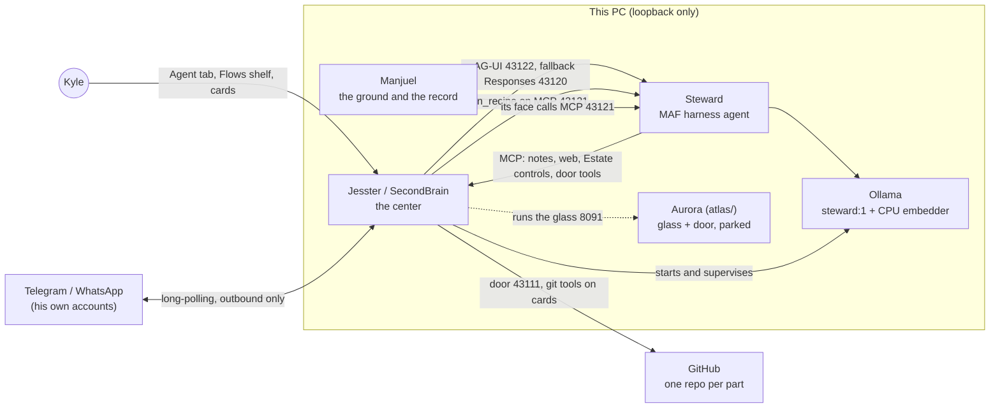
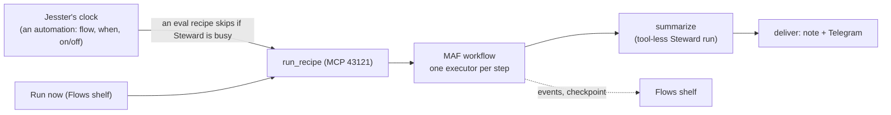

# The Estate's architecture

The one design document for the whole system (Neiro, "the Estate"): its parts, the wires between them, the data each
keeps, how work flows through it, the rules that bind it, and the build plan ahead. It is kept in Steward's
repository because Steward runs the Estate.

- **As of:** 2026-11-06 (ADRs 0001 to 0015, spec 001, ExecPlans 0001 to 0004).
- **Decisions:** every architectural decision is an ADR in [`decisions/`](decisions/README.md). Every architectural
  change gets an ADR before it is built, and this file is updated in the same pull request when a decision changes
  the shape (the operator, 2026-11-05: "make this the standard moving forward, this way nothing gets misaligned").
  A feature's design is a spec in [`specs/`](specs/spec-template.md); a multi-step build is an ExecPlan in
  [`plans/`](plans/README.md). [`README.md`](README.md) is the doc map.
- **Where this disagrees with an older document** (a README, the ground's SPEC.md, a SecondBrain note), this file and
  the ADRs win; the older one carries a dated pointer here.

## 1. The parts



| Part | Repository (GitHub) | Folder on this PC | What it is for |
|---|---|---|---|
| **Steward** | Steward | `worlds/steward` | The Estate's agent: a Microsoft Agent Framework (MAF 1.24) harness agent on local Ollama. Runs everything: code, tests, evals, automations and the Estate's controls. Every write is on Kyle's card. |
| **Jesster** (app: SecondBrain) | Jesster | `worlds/jesster` | The center ([ADR-0004](decisions/0004-jesster-is-the-center.md)): Steward's console (Agent tab and its shelves, Phone view, Flows shelf), the MCP hub, the automations' clock, the Estate's status with every part's version, and the supervisor of Steward's servers and Ollama. |
| **Manjuel** | Manjuel | `Desktop\Research` (the ground) | The ground and the record: the laws (`law/`), the vision (`foundation/`), the history (DAYBOOK, HANDOFF, CHANGELOG) and the Manjuel engine. Its default agent is Steward. |
| **Aurora** | Aurora (renamed from Atlas, 2026-11-05) | `atlas/` | The glass (8091) and the door's original code. Parked until Steward has visible computer control; its look is never changed. |
| **Ollama** | (upstream) | runs under SecondBrain | The model server, 127.0.0.1:11434: `steward:1` for every role ([ADR-0002](decisions/0002-one-model-for-everything.md)) and `embeddinggemma-2:270m` on the CPU. |
| **Neiro** | Neiro (archived) | `worlds/neiro` | The Estate's name. The repository and its lock are retired as a gate ([ADR-0004](decisions/0004-jesster-is-the-center.md)). |

### Steward, inside

- **The agent:** `harness/steward/step04_production_ready/agent.py`, `build_steward_agent`: MAF's harness agent with
  file access over his workspace, a shell behind approval, skills (file skills and SecondBrain's skill notes over
  MCP), CodeAct (Hyperlight sandbox when `STEWARD_SANDBOX=hyperlight`), background agents (CodeExplorer,
  WebResearchAgent), file memory, compaction, looping, OpenTelemetry with the HALO JSONL exporter.
- **The workflow:** `steward_workflow.py`: plan, the `approve_plan` card, execute (the plan's steps as todos), a
  model-free check (pytest), repair (at most 3 attempts), the `git_commit` card, report. Defined once and served by
  every host. A change always ends at the `git_commit` card, a docs change with no test to run too; EXECUTE stops and
  reports back (`stop_and_report`) when a step would make the result wrong or redundant against the request
  ([ADR-0015](decisions/0015-his-judgment-in-the-workflow.md)).
- **The hosts:** `hosted.py` (Responses, 43120), `ag_ui_app.py` (AG-UI, 43122), `mcp_app.py` (MCP, 43121, with
  `run_recipe` and `recipe_status`, and the Flows shelf's read-only `recipe_graph` and `recipe_runs`), `devui_app.py`
  (DevUI, for development only).
- **The improvement loop:** `improvement_loop_workflow.py`: one change, checks, Kyle's review (keep, drop, guidance),
  checkpointed.
- **Recipes:** `recipe_workflow.py`: a flow built as a MAF workflow ([ADR-0005](decisions/0005-automations-are-recipes-run-as-maf-workflows.md),
  [ADR-0009](decisions/0009-flows-are-ordered-tool-chains-automations-schedule-flows.md)).
- **Evals:** `evals.py`, `ext_sets.py`, `eval_transports.py` and the versioned sets in `harness/steward/evals/`
  ([ADR-0006](decisions/0006-evals-are-versioned-long-runs-at-night.md); they run whenever the operator says,
  [ADR-0009](decisions/0009-flows-are-ordered-tool-chains-automations-schedule-flows.md)). The bar is our own
  capability evals ([ADR-0012](decisions/0012-stewards-bar-is-our-own-capability-evals.md)); what each case covers is
  the coverage map, [spec 001](specs/001-capability-evals.md); the cases are built by
  [ExecPlan 0001](plans/0001-capability-evals-build.md).
- **Skills:** `harness/steward/skills/<name>/SKILL.md` (estate, github, automations, bar-runner, eval-history,
  telemetry, ollama-ops, approvals and others).
- **The Charter:** his instructions, the SecondBrain note `steward-charter` (v4.12 on 2026-11-05), read every turn.
  It changes only on the operator's word; a capability it adds or moves updates spec 001's map in the same pull
  request ([ADR-0012](decisions/0012-stewards-bar-is-our-own-capability-evals.md)).

## 2. The wires

All on loopback (127.0.0.1). Nothing listens on another interface.

| Port | Served by | Protocol | Who calls it |
|---|---|---|---|
| 43120 | Steward `hosted.py` | OpenAI Responses (MAF `ResponsesHostServer`) | Jesster, as the fallback transport; evals `--transport responses` |
| 43121 | Steward `mcp_app.py` | MCP (streamable HTTP) | Manjuel's face (`MANJUEL_MCP_STEWARD`), Aurora's `ask_steward` (atlas-mcp, Atlas #42), Jesster's `run_recipe` / `recipe_status`, and the Flows shelf's `recipe_graph` / `recipe_runs` (read-only) |
| 43122 | Steward `ag_ui_app.py` | AG-UI (MAF `agent_framework_ag_ui`) | Jesster's Agent tab, phone and automation turns (default, [ADR-0003](decisions/0003-ag-ui-is-the-default-transport.md)); evals `--transport ag-ui` |
| 43110 | Jesster (SecondBrain) | MCP, HTTP | Steward (notes, web search and fetch, skills, the Estate's tools: the reads, `service_control`, `ollama_unload`, `app_update`, `eval_start`; and `approval_ask`), and other MCP clients with a share key |
| 43111 | Jesster (`door/listen.cjs`) | MCP (the door) | Steward's door tools (git, branches, PRs, records; writes park as Kyle's cards) |
| stdio | the notes kernel's notes-only adapter, `cli.py --vault worlds/notes mcp --only notes` (Jesster #90) | MCP | Claude Code in the ground (its `.mcp.json`, Manjuel #101) and IDEs in the Jesster repository (Jesster #91): notes, `index.search`, `context.for` and `context.now` only (11 tools), on the same vault; no other kernel method group is served anywhere ([ADR-0010](decisions/0010-notes-are-central-in-jesster.md)) |
| 8091 | Aurora glass (`atlas-webapp.exe`, run by Jesster) | HTTP | Kyle's browser; parked |
| 11434 | Ollama | Ollama API | Steward (`OllamaChatClient`, embeddings) |

**Protocols** (audit 2026-11-05):

- **MCP 2026-07-28**, served beside 2025-06-18 so older clients still work (Jesster #68, #69; Atlas #44). Jesster's
  MCP server and the door refuse a request whose `Origin` is not loopback with 403, and its recipe calls to Steward
  carry `_meta` and the request headers (Jesster #87).
- **AG-UI** as MAF ships it (`agent-framework-ag-ui` 1.7.1, which pins `ag-ui-protocol` below 0.2). Approvals are
  AG-UI interrupts; workflow steps are StepStarted and StepFinished events, one pair per executor (named by its id;
  MAF adds a `superstep:<n>` pair per round), which Jesster's Agent tab and Phone view draw as the turn's step line
  (AG-UI step 3, 2026-11-05: Jesster #93 to #95; capability A12).
- **A2A** is deferred until a second autonomous agent exists; when it comes, it goes in Jesster, on loopback.
- **A2UI** is a pilot for the plan's approval card only ([ADR-0013](decisions/0013-a2ui-pilot-plan-card.md),
  2026-11-05): Steward's workflow builds the card's surface (A2UI v0.9, basic catalog) from the plan and sends it as a
  MAF custom workflow event (AG-UI CUSTOM `a2ui`) beside the card's interrupt; Jesster draws it with `@a2ui/react`
  and its own components, today's card the fallback; the answer is the AG-UI resume.
- **Outside the PC:** Telegram and WhatsApp on his own accounts, outbound only (RULE 4 as amended 2026-11-04); GitHub
  for the repositories. No hosted model is used unless the operator turns a route on.

## 3. Data each part keeps

| Part | Data | Where |
|---|---|---|
| Steward | Eval history (every run, with set name and version, transport, timings) | `storage/evals/history.jsonl` |
| Steward | Traces (OpenTelemetry-style JSONL, capped at 100 MB) | `halo_traces/traces.jsonl` |
| Steward | Recipe runs: checkpoints, MAF's events, and each run's state (its flow's id, trigger `now` or `schedule`, executors in order, result); the Flows shelf's run history reads these (`recipe_runs`) | `storage/recipes/checkpoints`, `storage/recipes/<run_id>.jsonl`, `storage/recipes/<run_id>.json` |
| Steward | Host state (Responses checkpoints) | `.as/` (gitignored) |
| Steward | Memory (durable facts by topic), the improvement loop's checkpoints | `agent-file-memory/`, `improvement_loop/checkpoints` |
| Steward | Eval sets, baselines, pinned outside data | `harness/steward/evals/` (versioned in git) |
| Steward | The capability map: every capability Steward must use, its source and its coverage, and the proposed case for each gap ([ADR-0012](decisions/0012-stewards-bar-is-our-own-capability-evals.md)) | `docs/specs/001-capability-evals.md` (versioned in git) |
| Steward | The design: this file, the ADRs, the specs and the ExecPlans ([README.md](README.md)) | `docs/`, `.agent/PLANS.md` |
| Jesster | The notes vault, the only one (Markdown; every save on Jesster's provenance chain). Reached through Jesster's MCP notes tools, or by a local IDE client through the kernel's notes-only adapter; no surface exposes the kernel's other methods, and the Archive digger is retired ([ADR-0010](decisions/0010-notes-are-central-in-jesster.md)) | `worlds/notes` |
| Jesster | Flows and automations (and legacy prompt-only schedules) | `<vault>/.secondbrain/schedules.json` |
| Jesster | Answered cards | `approvals-history.jsonl` |
| Manjuel | The record: laws, sittings ledger, DAYBOOK, HANDOFF, CHANGELOG, transcripts | the ground (`law/`, `sessions/`, `logs/`, root `.md`) |
| All | Keys and tokens | each part's `.env`, placed by the operator; never read, printed, copied or committed |

## 4. How work flows

### A request from Kyle

```mermaid
sequenceDiagram
    participant K as Kyle (Agent tab or Telegram)
    participant J as Jesster
    participant S as Steward workflow
    participant T as Tools (files, shell, MCP, door)
    K->>J: request
    J->>S: AG-UI turn, source line with local and UTC time
    S->>T: reads (no card)
    S->>J: plan (approve_plan interrupt)
    J->>K: card
    K->>J: Approve
    J->>S: resume (interruptId, checkpointId)
    S->>T: each write (its own card)
    S->>S: check: pytest; repair up to 3 times
    S->>J: git_commit card with the message
    J->>K: card
    S->>J: report
```

- Every turn starts with a source line naming the channel and the time ([ADR-0007](decisions/0007-time-is-stamped-by-jesster.md)).
  WhatsApp turns are chat and research only; no cards reach it: a change asked from WhatsApp is refused by the
  workflow before any plan, pointing to the PC or Telegram ([ADR-0014](decisions/0014-the-bounds-are-gates-in-code.md)).
- A plain question or a read-only request gets a plain answer, with no plan. A request his reading shows is already
  done is answered so, with what showed it, and no card; his reading before a plan is at most eight tool calls
  ([ADR-0015](decisions/0015-his-judgment-in-the-workflow.md)).
- A No on any card ends the run.
- Starting an eval in chat (`secondbrain_eval_start`) is an action like any other: it goes on the plan, and after
  the plan is approved it raises its own card ([ADR-0009](decisions/0009-flows-are-ordered-tool-chains-automations-schedule-flows.md)).
- A direct ask names one of his Estate actions by its tool name ("Run the bfcl eval set with eval_start, tag X"). It
  goes straight to the plan: its reading is offered only the Estate's reads, with no code search and no file read, and
  the plan and card follow as above. The T0 `direct` eval set checks it.

### A flow and an automation

[ADR-0009](decisions/0009-flows-are-ordered-tool-chains-automations-schedule-flows.md): a **flow** is an ordered
chain of steps, built on the Flows shelf's canvas ("+ New flow") and saved by itself. An **automation** is
`{flow, when, on/off}` and nothing else, made in the shelf's Set up. Run now runs a flow at once.



The Flows shelf draws a flow from its recipe built as the real MAF workflow (`recipe_graph`: `Workflow.to_dict()`),
or locally, marked "offline: drawn locally", when Steward's host is down. Under the open flow it lists the last runs
(`recipe_runs`: each run's trigger, result and per-step state and ms, read from MAF's events as they are; a step that
failed is MAF's non-fatal `error` event with its executor id); a click lights the canvas with that run's steps, and
a run going now is followed by reading `recipe_status` every few seconds until it ends.

The steps come from a fixed list (repo_log, merged_prs, releases, eval_bars, plan_left, versions, pull_ff,
eval_start, eval_wait). **A flow runs unattended by design:** the saved flow is the operator's approved plan, so no
step raises a card, and a step that could do harm is made safe in its own code (`pull_ff`: main only, a clean tree,
never during a sitting; `eval_start`: eval sets only, one at a time). There is no open-ended prompt type; prompt-only
schedules saved before 2026-11-05 keep running and are shown as legacy. Startup (weekdays 06:00) is the baseline.

### An eval

- **The bar is our own capability evals** ([ADR-0012](decisions/0012-stewards-bar-is-our-own-capability-evals.md);
  the operator, 2026-11-05: "our evals are literally "can he do what is needed for the system reliably""). One small
  deterministic case per capability Steward must use, scored by `evaluate_agent` with `LocalEvaluator` (MAF's checks
  and our `@evaluator` functions: a tool called, a card raised and honoured, a rule kept, a file's state); no model
  judge, no long runs. The capabilities, from the Charter, this file and the ADRs, are listed with their coverage in
  [spec 001](specs/001-capability-evals.md) (75 on 2026-11-05: 6 covered, 14 partly, 55 untested). They are grouped
  into the dev-path tiers (T0 and T1 met; T2 his own work, T3 Estate operations, T4 GitHub, then T5 to T7), and a
  tier's bar is all of its cases, twice in a row. Outside sets (BFCL, Aider Python) stay tier `ext`, calibration
  only; the parity set of [ADR-0011](decisions/0011-harness-parity-set.md) was rejected.
- **Everything he does has an eval** (ADR-0012, amended 2026-11-05: "all modules and skills, any capabilities always
  come with an eval set for testing"): the map is data, `harness/steward/evals/capabilities.yaml`; every case names its
  capability ids; `evals.py validate` (the gate) fails a skill folder or a tool of his that the map does not name, a
  case with an unknown id, and a required capability with no case. T3 `bounds` (`t3-bounds.yaml`, the `standins`
  runner) holds spec 001's first ten cases, the tools the eval build lacks given as declaration-only stand-ins.
- **Whenever the operator says,** day or night: from a flow, an automation, or a request in chat (planned and
  carded). One at a time, each set in its own window (`run-bar.ps1`), never two at once.
- An eval flow is `eval_start` then `eval_wait`. `eval_start` opens `run-bar.ps1` in its own window with
  Start-Process and verifies that the run began, and sends a host transport (AG-UI) only when every set is an asks set
  (Jesster #92); `eval_wait` waits for the run to begin, and a run that never began fails the flow and is not
  summarized (Steward #161).
- Outside sets are read for calibration only. BFCL's first run, 2026-11-05 at `d71fb78` (in-process, `steward:1`):
  36/80 (24/65 AST, 12/15 irrelevance). Never a gate, never tuned on.
- Every eval run is scored by MAF's `evaluate_agent` with `LocalEvaluator`, and lands in the history with its set
  version; the steps set scores each workflow step with its own `LocalEvaluator` (`evals.py`). A gating tier runs each
  case once. Recipe (flow) runs are not evaluated yet: `evaluate_workflow` on a flow's run is the Flows shelf's piece 5
  (corrected 2026-11-05: this line said every run was scored by `evaluate_workflow`, which nothing calls yet).

## 5. The rules that bind the design

From the ground's CLAUDE.md and laws; they are not relaxed by any design here.

- **Keys are silent (RULE 7).** `.env` is never read, printed, copied, committed, indexed or put on a command line.
  Every file tool refuses `.env*`.
- **The Archive never goes on GitHub.** Not a file, a path, a fixture or a log that carries it. `worlds/` stays out of
  the core's remote.
- **The bounds are gates in code** ([ADR-0014](decisions/0014-the-bounds-are-gates-in-code.md), 2026-11-06). At the
  call, before any card (`bounds_gate` and its auto-approval rule): any tool's path naming `.env*` or a key file, or a
  path under `Desktop\Archive`, is refused; the host shell is refused once untrusted content (a note, an Estate read,
  the web) is in the session, whatever the FIDES and sandbox switches say; a write to the ground is refused while a
  sitting is open. At the request and the plan (the workflow's `refuse` step and its plan reader): a change asked from
  WhatsApp, a change to the ground while a sitting is open, or an Archive path named, is refused with no plan card.
- **The gate is Kyle's.** For Steward, every write, shell command, commit, push and Estate change is his card. No
  force-push, tag, release or history rewrite without his word for that act. No agent puts its own name on his work.
  The hand's exception (the ground's CLAUDE.md RULE 12, 2026-11-03 and 11-04): until Steward runs it reliably, the
  coding agent working for the operator runs git and GitHub from its own shell for Steward, Jesster, Aurora, Neiro and
  the ground (branches, commits, pushes, pull requests, merging on green), with Kyle as author and no cards.
- **The sitting rule (RULE 9).** Nothing in Manjuel's ground is edited while a sitting is open (held in code:
  ADR-0014).
- **Local first (RULE 4, as amended).** Ollama on this PC; his own integrations on his own accounts; a hosted route
  only on his terms.
- **Each repository's CI and protected main is its gate.** Changes land only through a pull request whose checks
  passed.
- **The harness, not the model.** A failure is fixed in the task, the context, the tools or the check, never by a
  bigger model.
- **Name the wire.** Every piece has a test that goes red when it is unplugged.
- **The card rule.** In chat, everything that changes something is planned and carded, `eval_start` included. A
  saved flow runs unattended by design: the flow is the approval
  ([ADR-0009](decisions/0009-flows-are-ordered-tool-chains-automations-schedule-flows.md)).
- **His system, his hours.** Evals and flows run whenever the operator says, day or night (ADR-0009; this replaced
  "By day Steward is Kyle's. Long evals and heavy automations run at night", 2026-11-05).
- **Every capability has an eval.** Everything Steward does has a small deterministic case in its tier, so he can
  prove himself (the operator's rule, 2026-11-05; [ADR-0012](decisions/0012-stewards-bar-is-our-own-capability-evals.md)).
- **The doc standard.** An ADR before any change to a part, a wire, a store of data or a rule; a spec for a feature;
  an ExecPlan for a multi-step build; this file in the same pull request when the shape moves
  ([README.md](README.md); the operator, 2026-11-05: "make this the standard moving forward, this way nothing gets
  misaligned").

## 6. The build plan ahead

In order, as of 2026-11-05 evening. Each item is one piece and one pull request at a time, with its wire and, from
ADR-0012, its eval case. A multi-step item has an ExecPlan in [`plans/`](plans/README.md), which is where its
progress is kept. _(Rewritten 2026-11-05 evening; the earlier list is in this file's history. Built from it on
2026-11-05: the Flows shelf's run history and its canvas drawn from the MAF graph (Steward #158, Jesster #89); flows
and automations per ADR-0009, Set up as automations, the prompt type removed, BFCL and Aider as eval flows (Steward
#156, Jesster #88, #92; Steward #161).)_

1. **The capability-eval wire and the first ten T3 cases:** _built 2026-11-05 (Steward #164)_: the map as data
   (`harness/steward/evals/capabilities.yaml`), every case naming its capability ids, `evals.py validate` failing an
   unknown id, a case with none, a required capability with no case, or a skill or tool the map does not name; and
   T3 `bounds` (`t3-bounds.yaml` v1: P29, P30, P56, P1, P31, P32, P33, P58, P34, P36) on the `standins` runner. Next:
   its bar, run twice on the operator's word ([ADR-0012](decisions/0012-stewards-bar-is-our-own-capability-evals.md),
   [spec 001](specs/001-capability-evals.md), [ExecPlan 0001](plans/0001-capability-evals-build.md), Milestones 1
   and 2).
2. **The remaining cases by risk:** the rest of T3, then T2, then T4 (the rest of spec 001's P1 to P60), and each tier's bar met
   twice in a row on the operator's word ([ExecPlan 0001](plans/0001-capability-evals-build.md), Milestones 3 to 6).
   Then the `eval-author` skill; T5 restated now that Neiro is retired; T6 and T7 grow with his reach.
3. **Flows: Steward's card and `automation_save`** on Kyle's card, then evals in flow (`evaluate_workflow` on a
   recipe run) ([ADR-0008](decisions/0008-the-flows-shelf.md),
   [ADR-0009](decisions/0009-flows-are-ordered-tool-chains-automations-schedule-flows.md),
   [ExecPlan 0002](plans/0002-flows-steward-card-and-automation-save.md)).
4. **AG-UI step 3:** the console and the Phone view show the workflow's steps from AG-UI's STEP events (built
   2026-11-05, Jesster #93 to #95); then the A2UI pilot for the plan's card
   ([ADR-0003](decisions/0003-ag-ui-is-the-default-transport.md), [ExecPlan 0003](plans/0003-ag-ui-step-3.md);
   [ADR-0013](decisions/0013-a2ui-pilot-plan-card.md), [ExecPlan 0004](plans/0004-a2ui-pilot-plan-card.md)).
5. **Reach widens on each tier's bar:** GitHub for his own repository passes from the hand to Steward after T2; then
   Jesster, Manjuel and Aurora one at a time.
6. **Held on MAF defects:** FIDES enforcement (behind `STEWARD_FIDES_ENFORCE`, off) and Agent Hooks
   ([ADR-0001](decisions/0001-steward-is-a-maf-harness-agent.md), items 8 and 9); checked against each MAF release.
7. **Aurora:** visible computer control for Steward, when the operator says so
   ([ADR-0004](decisions/0004-jesster-is-the-center.md)).

The SecondBrain notes below hold discussion and status, and each says at its top that this folder is the design of
record (2026-11-05 evening):

- `plan-steward-controls-the-estate-under-m-c9f628`: the Estate under MAF, its waves and status.
- `steward-s-dev-path-evals-that-grow-with--cb3211`: the eval tiers and what each bar unlocks.
- `plan-the-flows-shelf-ide-for-steward-s-f-04a93a`: the Flows shelf.
- `overnight-plan-steward-s-bar-and-develop-7d69e1`: the bar's night loops and log.
- `guidance-developing-steward-and-the-esta-27bfd2`: how every hand builds here.
- `design-the-estate-s-architecture-and-adr-7d6e52`: the index of this folder.
- `steward-charter`: Steward's instructions.
